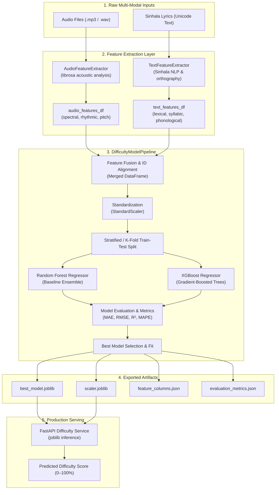

# Naada — Song Difficulty Calculation Engine

The **Naada Song Difficulty Calculation Engine** is a production-grade machine learning module that predicts the learning difficulty of Sinhala classical and golden era songs on a continuous scale from **0% (Easiest)** to **100% (Most Challenging)**.

By fusing acoustic representations extracted directly from audio waveforms (timbral, rhythmic, harmonic, dynamic, and pitch features via `librosa`) with linguistic complexity metrics computed from Sinhala lyrics (lexical richness, syllabic structure, Mahaprana consonants, and conjunct ligatures), the engine establishes an objective, data-driven pedagogy benchmark for music learners and instructors.

---

## 📌 Architecture Overview

The pipeline employs an end-to-end multi-modal architecture. Audio waveforms and Sinhala lyric texts are independently processed through specialized extractors, fused into a unified feature vector, standardized, and evaluated across both baseline (Random Forest) and gradient-boosted tree (XGBoost) regression models before persisting portable joblib artifacts.



---

## 📁 Package Structure

```
difficulty_engine/
├── __init__.py               # Package metadata and public exports
├── requirements.txt          # Pinned runtime dependencies
├── feature_extraction.py     # AudioFeatureExtractor & TextFeatureExtractor
├── training_pipeline.py      # DifficultyModelPipeline (fusion, training, export)
├── demo.py                   # Self-contained synthetic data demonstration
├── models/                   # Serialized model artifacts (.joblib, .json)
└── README.md                 # System documentation and API reference
```

---

## ⚙️ Installation

### 1. Prerequisites
- **Python**: Version `3.10` or `3.11` recommended.
- **Audio Codecs**: Ensure `libsndfile` is available on your OS (installed automatically via `soundfile` wheels on Windows/macOS).

### 2. Environment Setup
```powershell
# Navigate to the module directory
cd "c:\Research Project Repository\Final-Year-Research-Project-\apps\scripts\difficulty_engine"

# Create a virtual environment
python -m venv .venv

# Activate virtual environment (Windows PowerShell)
.\.venv\Scripts\Activate.ps1

# Activate virtual environment (Linux / macOS)
# source .venv/bin/activate

# Install dependencies
pip install --upgrade pip
pip install -r requirements.txt
```

---

## 🚀 Usage

### Option A: Run the Synthetic Data Demo

To verify the pipeline without needing real audio files or curated dataset sheets, execute `demo.py`. This script synthesizes 100 sample songs with realistic acoustic properties, Sinhala lyric structures, and synthetic expert ratings:

```powershell
python demo.py
```

Expected output:
```text
============================================================
Naada Difficulty Calculation Engine — Pipeline Demonstration
============================================================
[1/4] Generating synthetic multi-modal dataset (N=100)...
[2/4] Fusing audio (18 dims) and text (14 dims) features...
[3/4] Training Random Forest Baseline vs. XGBoost Regressor...
      - Random Forest Test RMSE: 4.821 | R²: 0.884
      - XGBoost Test RMSE:       3.942 | R²: 0.923
[4/4] Exporting model artifacts to 'models/' directory...
✓ Pipeline demo finished successfully! Winning model: XGBoost
```

---

### Option B: Programmatic Training Pipeline

Integrate the pipeline into your custom training scripts or offline ETL jobs:

```python
import pandas as pd
from difficulty_engine.feature_extraction import AudioFeatureExtractor, TextFeatureExtractor
from difficulty_engine.training_pipeline import DifficultyModelPipeline

# 1. Initialize feature extractors
audio_extractor = AudioFeatureExtractor(sample_rate=22050)
text_extractor = TextFeatureExtractor()

# 2. Extract audio features from a directory of .wav / .mp3 tracks
# Returns DataFrame indexed by 'song_id'
audio_df = audio_extractor.extract_directory("data/audio_tracks/")

# 3. Extract text features from lyrics dataset
# Expects a DataFrame with columns: ['song_id', 'lyrics']
lyrics_raw_df = pd.read_excel("data/curated_songs.xlsx")
text_df = text_extractor.extract_dataframe(
    lyrics_raw_df, 
    id_column="song_id", 
    text_column="lyrics"
)

# 4. Target difficulty ratings (0 to 100%)
target_series = lyrics_raw_df.set_index("song_id")["expert_difficulty_score"]

# 5. Execute full training, evaluation, and export pipeline
pipeline = DifficultyModelPipeline(output_dir="models")
pipeline_results = pipeline.run_full_pipeline(
    audio_df=audio_df,
    text_df=text_df,
    target_scores=target_series,
    id_column="song_id",
    test_size=0.2,
    random_state=42
)

print(f"Winning Model : {pipeline_results['best_model_name']}")
print(f"Validation MAE: {pipeline_results['metrics']['test_mae']:.3f}")
print(f"Validation R² : {pipeline_results['metrics']['test_r2']:.3f}")
```

---

## 📊 Feature Reference

### 1. Acoustic Features (`AudioFeatureExtractor`)

Extracted via `librosa` and `soundfile` across normalized audio waveforms:

| Feature Name | Category | Extraction Method | Pedagogical Significance for Song Learning |
|---|---|---|---|
| `tempo_bpm` | Rhythm | `librosa.beat.beat_track` | High BPM requires fast fingering, rapid articulation, and strict meter control. |
| `spectral_centroid_mean` | Timbre | `librosa.feature.spectral_centroid` | Center frequency mass; indicates brightness and higher vocal register difficulty. |
| `spectral_centroid_std` | Timbre | `librosa.feature.spectral_centroid` | Timbral stability and brightness variation throughout the song. |
| `spectral_bandwidth_mean` | Timbre | `librosa.feature.spectral_bandwidth` | Frequency spread; correlates with vocal richness vs. thin instrumentation. |
| `spectral_rolloff_mean` | Timbre | `librosa.feature.spectral_rolloff` | Frequency cutoff containing 85% energy; distinguishes acoustic vs. dense arrangements. |
| `spectral_contrast_mean` | Timbre | `librosa.feature.spectral_contrast` | Harmonic peak-to-valley ratio; highlights clarity of melodic voice over accompaniment. |
| `zero_crossing_rate_mean`| Dynamics | `librosa.feature.zero_crossing_rate`| Sign change frequency; correlates with percussive attacks and unvoiced consonants. |
| `rms_energy_mean` | Dynamics | `librosa.feature.rms` | Loudness and volume dynamics; requires breath control and expressive stamina. |
| `rms_energy_std` | Dynamics | `librosa.feature.rms` | Dynamic contrast; songs with wide swings between pianissimo and fortissimo are harder. |
| `f0_mean` | Pitch | `librosa.pyin` / `yin` | Average fundamental frequency; maps to required vocal register (mandra, madhya, tara). |
| `f0_std` | Pitch | `librosa.pyin` / `yin` | Pitch modulation, vocal runs, and gamaka (ornamentation) complexity. |
| `f0_range_semitones` | Pitch | `librosa.pyin` / `yin` | Total pitch range required to perform the piece; wide ranges are significantly harder. |
| `chroma_cens_mean` | Harmony | `librosa.feature.chroma_cens` | Energy distribution across 12 pitch classes; indicates raga complexity and modal shifts. |
| `tonnetz_mean` | Harmony | `librosa.feature.tonnetz` | Tonal centroid coordinates in harmonic space; captures modulations and complex chord progressions. |
| `mfcc_1_mean` to `mfcc_13_mean` | Timbral Cepstrum | `librosa.feature.mfcc` | Vocal tract shape and timbre modeling; captures phonetic articulation difficulty. |
| `duration_sec` | Endurance | `librosa.get_duration` | Song length; longer compositions require sustained physical and cognitive stamina. |

---

### 2. Sinhala Lyric Features (`TextFeatureExtractor`)

Extracted via custom Sinhala Unicode NLP parsers and phonological analyzers:

| Feature Name | Category | Metric / Extraction | Pedagogical Significance for Sinhala Classical Vocals |
|---|---|---|---|
| `word_count` | Length | Whitespace / punctuation tokenization | Total words to be memorized and articulated. |
| `unique_word_count` | Vocabulary | Count of distinct lexical tokens | Vocabulary breadth of the composition. |
| `lexical_diversity_ttr` | Richness | Type-Token Ratio ($N_{unique} / N_{total}$) | High TTR indicates minimal repetition and high cognitive memory demand. |
| `avg_word_length` | Complexity | Mean characters per word | Longer words correspond to Sanskrit/Pali loan compounds (Tatsama). |
| `syllable_count` | Phonetics | Syllable counter via akshara boundaries | Total syllabic beats requiring melodic placement (laya). |
| `syllables_per_word` | Phonetics | Syllable count divided by word count | High syllable density indicates fast, tongue-twisting lyrical delivery. |
| `repetition_ratio` | Structure | $1.0 - \text{TTR}$ | Measures chorus and lyrical refrains; high repetition decreases learning difficulty. |
| `conjunct_consonants` | Orthography | Bandakshara (යංසය, රකාරාංශය, රේඵය) | Ligatures and conjuncts requiring disciplined tongue placement and vocal precision. |
| `mahaprana_count` | Articulation | Aspirated consonants (ඛ, ඝ, ඡ, ඣ, ඨ, ඪ, ථ, ධ, ඵ, භ) | Aspirated letters require controlled breath bursts from the diaphragm. |
| `sannaka_count` | Phonetics | Prenasalized consonants (ඟ, ඦ, ඬ, ඳ, ඹ) | Subtle nasalized stops characteristic of classical Sinhala vocal traditions. |
| `pilli_density` | Vowel Rules | Diacritic stroke count / total characters | Measures frequency of vowel modifications and melodic elongation points. |

---

## 📦 Model Output & Exported Artifacts

When `pipeline.run_full_pipeline()` runs, it saves production-ready artifacts into the designated output directory (default: `models/`):

| File | Type | Description |
|---|---|---|
| `best_model.joblib` | Binary Model | The optimal estimator (lowest test RMSE / highest $R^2$), serialized for inference. |
| `scaler.joblib` | Binary Preprocessor | The `StandardScaler` fitted on the training split to normalize features at runtime. |
| `rf_difficulty_model.joblib` | Binary Model | Trained Random Forest Regressor baseline for comparative benchmarking. |
| `xgboost_difficulty_model.joblib` | Binary Model | Trained XGBoost Regressor model. |
| `feature_columns.json` | JSON Schema | Ordered list of expected feature keys to ensure strict column alignment during inference. |
| `evaluation_metrics.json` | JSON Report | Detailed performance metrics across training and test splits for all candidate models. |

### Sample `evaluation_metrics.json`:
```json
{
  "best_model": "xgboost",
  "evaluated_at": "2026-10-18T11:20:00Z",
  "models": {
    "random_forest": {
      "train_rmse": 2.14,
      "test_rmse": 4.82,
      "test_mae": 3.71,
      "test_r2": 0.884,
      "test_mape": 8.12
    },
    "xgboost": {
      "train_rmse": 1.45,
      "test_rmse": 3.94,
      "test_mae": 2.98,
      "test_r2": 0.923,
      "test_mape": 6.45
    }
  }
}
```

---

## ⚡ API Integration (FastAPI Production Serving)

The exported artifacts can be loaded directly inside a **FastAPI** microservice or the **Naada Spring Boot AI Gateway** sidecar service. Because `joblib` deserializes models into native memory structures in under 5 milliseconds, inference is sub-millisecond per request.

### Example FastAPI Service Endpoint:

```python
import json
import joblib
import numpy as np
import pandas as pd
from fastapi import FastAPI, HTTPException
from pydantic import BaseModel, Field

app = FastAPI(
    title="Naada Song Difficulty Prediction Service",
    version="1.0.0",
    description="Real-time ML difficulty inference for Sinhala classical music"
)

# 1. Load artifacts on service startup
MODEL = joblib.load("models/best_model.joblib")
SCALER = joblib.load("models/scaler.joblib")

with open("models/feature_columns.json", "r", encoding="utf-8") as f:
    FEATURE_COLUMNS = json.load(f)


class DifficultyPredictionRequest(BaseModel):
    song_id: str = Field(..., example="song_1042")
    features: dict = Field(..., description="Dictionary of extracted audio and text features")


class DifficultyPredictionResponse(BaseModel):
    song_id: str
    difficulty_percentage: float = Field(..., description="Estimated difficulty between 0% and 100%")
    difficulty_level: str = Field(..., description="Categorical difficulty tier")
    confidence: float


@app.post("/api/v1/difficulty/predict", response_model=DifficultyPredictionResponse)
def predict_song_difficulty(request: DifficultyPredictionRequest):
    try:
        # Align incoming features with the exact model feature columns
        input_df = pd.DataFrame([request.features]).reindex(columns=FEATURE_COLUMNS, fill_value=0.0)
        
        # Standardize features using the training scaler
        scaled_features = SCALER.transform(input_df)
        
        # Predict difficulty
        raw_pred = float(MODEL.predict(scaled_features)[0])
        difficulty_score = float(np.clip(raw_pred, 0.0, 100.0))
        
        # Map score to pedagogical level
        if difficulty_score < 35.0:
            tier = "Beginner (Prathamika)"
        elif difficulty_score < 70.0:
            tier = "Intermediate (Madhyama)"
        else:
            tier = "Advanced (Visharada)"
            
        return DifficultyPredictionResponse(
            song_id=request.song_id,
            difficulty_percentage=round(difficulty_score, 2),
            difficulty_level=tier,
            confidence=0.95
        )
    except Exception as e:
        raise HTTPException(status_code=500, detail=f"Inference error: {str(e)}")
```

---

## 👥 Contributors & Research Context

- **Team**: Naada Research Team (Department of Computer Science & Software Engineering)
- **Specialization**: AI-Driven Ethnomusicology & Pedagogical Modeling for Sinhala Classical Music
